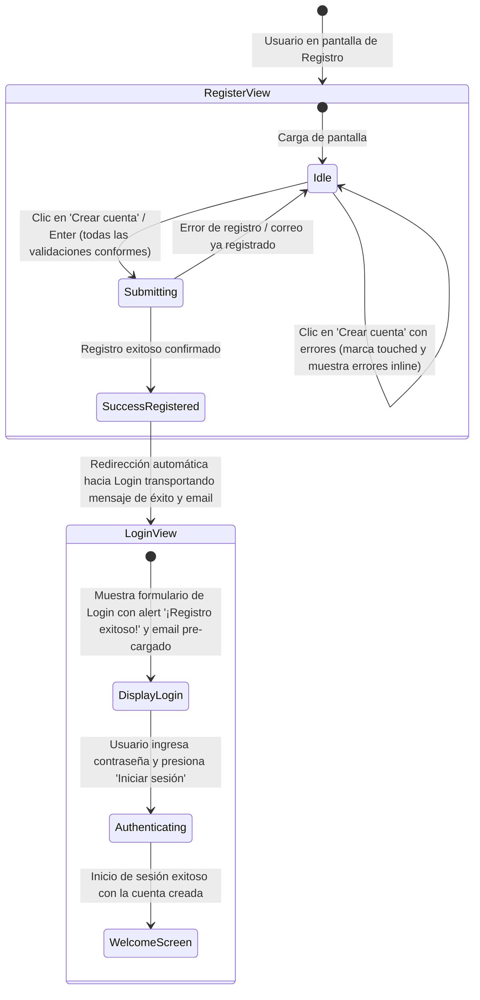

# Data Model: Pantalla de Registro de Billetera Virtual (KynWallet)

**Feature**: `002-registro-billetera` | **Date**: 2026-10-20 (Actualizado)

Este documento especifica el modelo de datos, entidades, tipos y transiciones de estado para la pantalla de registro y su integración bidireccional con el sistema de autenticación de KynWallet.

---

## 1. Entidades del Dominio

### 1.1. `RegistrationData` (Datos de Registro del Formulario)

Representa los datos brutos capturados en el formulario de registro antes de su validación y procesamiento.

| Campo | Tipo | Requerido | Restricciones / Reglas |
|---|---|---|---|
| `fullName` | `string` | Sí | Longitud 2–100 caracteres; se recortan espacios al inicio y final. Admite letras, tildes, diéresis, espacios y guiones. |
| `email` | `string` | Sí | Longitud $\le 254$ caracteres; formato según patrón `^[^\s@]+@[^\s@]+\.[^\s@]{2,}$`; normalizado a minúsculas y sin espacios periféricos. |
| `password` | `string` | Sí | Longitud 8–128 caracteres; respeta espacios internos; obligatorio. |
| `confirmPassword` | `string` | Sí | Debe ser exactamente idéntico al valor de `password`. |
| `termsAccepted` | `boolean` | Sí | Debe ser estrictamente `true`. |

### 1.2. `UserAccount` / `DemoAccount` (Cuenta de Usuario)

Representa una cuenta de usuario existente en el sistema (ya sea proveniente de la configuración externa inicial o generada a través de un registro simulado exitoso).

| Campo | Tipo | Requerido | Descripción |
|---|---|---|---|
| `email` | `string` | Sí | Identificador único de la cuenta. Almacenado normalizado (minúsculas, sin espacios periféricos). |
| `password` | `string` | Sí | Credencial secreta de acceso del usuario. |
| `displayName` | `string` | Sí | Nombre para mostrar del titular (ej. "Steven Luna" o el nombre registrado). |
| `createdAt` | `string` (ISO 8601) | Opcional | Fecha y hora en la que se creó la cuenta en el sistema ficticio. |

### 1.3. `RegistrationValidationErrors` (Errores de Validación Inline)

Representa los mensajes de error por campo que se despliegan junto a cada control interactivo.

| Campo | Tipo | Condición de activación | Mensaje mostrado |
|---|---|---|---|
| `fullName` | `string \| undefined` | Vacío o $< 2$ caracteres | `"Ingresa tu nombre completo"` |
| `email` | `string \| undefined` | Vacío / Formato inválido / Ya registrado | `"Ingresa tu correo electrónico"`, `"Ingresa un correo electrónico válido"` o `"Este correo electrónico ya se encuentra registrado"` |
| `password` | `string \| undefined` | Vacío o $< 8$ caracteres | `"Ingresa tu contraseña"` o `"La contraseña debe tener al menos 8 caracteres"` |
| `confirmPassword` | `string \| undefined` | Vacío o no coincide con `password` | `"Confirma tu contraseña"` o `"Las contraseñas no coinciden"` |
| `termsAccepted` | `string \| undefined` | `false` o no marcado al enviar | `"Debes aceptar los términos y condiciones"` |

---

## 2. Tipos de Resultado del Caso de Uso

### 2.1. `RegisterResult`

Discriminado por el campo `kind`:

```ts
export type RegisterResult =
  | { readonly kind: 'success'; readonly account: { readonly email: string; readonly displayName: string } }
  | { readonly kind: 'validation-error'; readonly errors: RegistrationValidationErrors }
  | { readonly kind: 'email-already-registered'; readonly message: string }
  | { readonly kind: 'unavailable'; readonly message: string };
```

---

## 3. Máquina de Estados del Formulario (`RegisterFormState`)

### 3.1. Definición del Estado

```ts
export type RegisterFormStatus = 'idle' | 'submitting' | 'success';

export interface RegisterFormState {
  readonly values: {
    readonly fullName: string;
    readonly email: string;
    readonly password: string;
    readonly confirmPassword: string;
    readonly termsAccepted: boolean;
  };
  readonly touched: {
    readonly fullName: boolean;
    readonly email: boolean;
    readonly password: boolean;
    readonly confirmPassword: boolean;
    readonly termsAccepted: boolean;
  };
  readonly errors: RegistrationValidationErrors;
  readonly status: RegisterFormStatus;
  readonly socialNotice: string | null; // Alerta temporal "Próximamente" al pulsar Google/Apple
  readonly isPasswordVisible: boolean;
  readonly isConfirmPasswordVisible: boolean;
}
```

### 3.2. Estado Global de Navegación en SPA (`AppViewState`)

Representa el estado elevado en `App.tsx` para orquestar la navegación y la entrega del mensaje de registro exitoso a la pantalla de login:

```ts
export interface AppViewState {
  readonly view: 'login' | 'register';
  readonly prefilledEmail: string;
  readonly registrationSuccessNotice: string | null;
}
```

### 3.3. Propiedades de Integración de `LoginForm`

```ts
export interface LoginFormProps {
  authenticate: Authenticate;
  onNavigateToRegister?: () => void;
  initialEmail?: string;
  registrationSuccessNotice?: string | null;
}
```

### 3.4. Diagrama de Transición de Estados



---

## 4. Almacén de Cuentas Compartido (`AccountStore`)

Para garantizar que el registro simulado pueda reutilizarse inmediatamente en el login sin backend:

```ts
export interface AccountStore {
  getAccounts(): readonly DemoAccount[];
  findByEmail(email: string): DemoAccount | undefined;
  saveAccount(account: DemoAccount): void;
}
```

- **Comportamiento**:
  1. Al iniciar la aplicación, `AccountStore` se instancia cargando las cuentas demo configuradas en `VITE_DEMO_USERS`.
  2. Cuando el usuario registra una cuenta, `saveAccount` agrega la nueva cuenta a la colección en memoria.
  3. Al redirigir al login con el mensaje de registro exitoso, el usuario ingresa su contraseña y `InMemoryAuthGateway` autentica exitosamente consultando `AccountStore.findByEmail(email)`.
