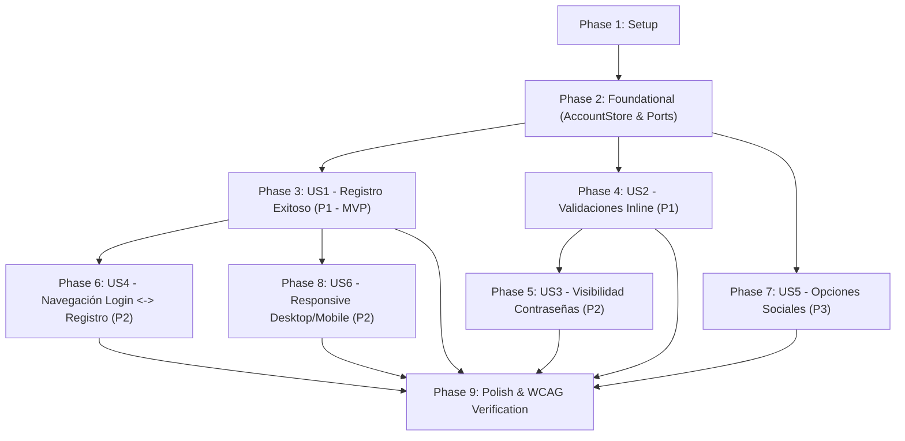

# Implementation Tasks: Pantalla de Registro de Billetera Virtual (KynWallet)

**Feature**: `002-registro-billetera` | **Date**: 2026-10-19 | **Spec**: [spec.md](./spec.md) | **Plan**: [plan.md](./plan.md)

Este documento contiene la lista detallada y secuencial de tareas de desarrollo para la pantalla de registro, organizada por historias de usuario y prioridades, respetando el ciclo TDD no negociable (Constitución I), Clean Architecture (Constitución III) y WCAG 2.1 AA (Constitución 8.4).

---

## Phase 1: Setup (Shared Infrastructure)

**Purpose**: Verificación de configuración inicial y herramientas de prueba para el feature de registro.

- [X] T001 Verificar variables de entorno base en `.env.local` y tokens de diseño en `src/ui/styles/tokens.css` per plan.md
- [X] T002 [P] Extender fixtures de prueba en `src/test/fixtures.ts` y helpers en `src/test/setup.ts` para soportar datos de registro simulados

---

## Phase 2: Foundational (Blocking Prerequisites)

**Purpose**: Infraestructura transversal y contratos del dominio que DEBEN estar completados antes de implementar las historias de usuario.

**⚠️ CRITICAL**: Ningún desarrollo de historia de usuario puede comenzar hasta que esta fase esté finalizada.

- [X] T003 [P] Declarar tipos del dominio `RegistrationData`, `RegisterResult` y `RegistrationValidationErrors` en `src/domain/auth.ts`, con restricciones: `fullName` (2-100 caracteres), `email` (patrón `^[^\s@]+@[^\s@]+\.[^\s@]{2,}$`, máx 254), `password` (8-128 caracteres), `confirmPassword` (coincidencia exacta) y `termsAccepted` (`true`)
- [X] T004 [P] Incorporar constantes de mensajes de validación y retroalimentación para registro en `src/domain/messages.ts` ("Ingresa tu nombre completo", "Ingresa tu correo electrónico", "Ingresa un correo electrónico válido", "La contraseña debe tener al menos 8 caracteres", "Confirma tu contraseña", "Las contraseñas no coinciden", "Debes aceptar los términos y condiciones", "Este correo electrónico ya se encuentra registrado", "¡Registro exitoso! Redirigiendo a iniciar sesión...", "Próximamente")
- [X] T005 [P] Definir interfaz del puerto `AccountStore` en `src/application/ports/AccountStore.ts` per contracts/registration-gateway.md
- [X] T006 [P] Definir interfaz del puerto `RegistrationGateway` en `src/application/ports/RegistrationGateway.ts` per contracts/registration-gateway.md
- [X] T007 Escribir pruebas unitarias para `InMemoryAccountStore` en `src/infrastructure/InMemoryAccountStore.test.ts`
- [X] T008 Implementar `InMemoryAccountStore` en `src/infrastructure/InMemoryAccountStore.ts` para almacenar cuentas en memoria compartidas entre registro y login
- [X] T009 Refactorizar `InMemoryAuthGateway` en `src/infrastructure/InMemoryAuthGateway.ts` y sus pruebas en `src/infrastructure/InMemoryAuthGateway.test.ts` para consumir `AccountStore` en lugar de una lista estática

**Checkpoint**: Almacén compartido de cuentas y contratos listos. Las historias de usuario pueden implementarse de forma independiente.

---

## Phase 3: User Story 1 - Creación exitosa de cuenta de usuario (Priority: P1) 🎯 MVP

**Goal**: Permitir que un nuevo usuario complete el formulario con datos válidos, acepte los términos y condiciones, presione "Crear cuenta", observe el estado de carga y reciba el mensaje de registro exitoso, persistiendo la cuenta en el almacén en memoria para su uso posterior.

**Independent Test**: Completar todos los campos obligatorios con datos válidos y términos marcados, presionar "Crear cuenta", y verificar que la cuenta se registra en el almacén, se muestra la notificación de éxito y se activa la transición a login.

### Tests for User Story 1 ⚠️
> **NOTA: Escribir estas pruebas primero y verificar que FALLAN antes de implementar el código**

- [X] T010 [P] [US1] Escribir prueba unitaria para el caso de uso `register` en `src/application/register.test.ts`
- [X] T011 [P] [US1] Escribir prueba unitaria para el adaptador `InMemoryRegistrationGateway` en `src/infrastructure/InMemoryRegistrationGateway.test.ts`
- [X] T012 [P] [US1] Escribir prueba unitaria del reducer de registro para el flujo de envío exitoso (`idle -> submitting -> success`) en `src/ui/features/register/registerReducer.test.ts`
- [X] T013 [P] [US1] Escribir pruebas de componente para el envío exitoso, deshabilitación por carga (`aria-busy`) y soporte de envío con tecla Enter en `src/ui/features/register/RegisterForm.test.tsx`

### Implementation for User Story 1

- [X] T014 [US1] Implementar caso de uso `register` en `src/application/register.ts` delegando la creación en `RegistrationGateway`
- [X] T015 [US1] Implementar adaptador `InMemoryRegistrationGateway` en `src/infrastructure/InMemoryRegistrationGateway.ts` persistiendo en `AccountStore` con retardo simulado de 800ms
- [X] T016 [US1] Implementar `registerReducer` básico y acciones de envío en `src/ui/features/register/registerReducer.ts`
- [X] T017 [US1] Implementar hook `useRegisterForm` en `src/ui/features/register/useRegisterForm.ts` exponiendo estado y manejador `handleSubmit`
- [X] T018 [US1] Construir componente `RegisterForm` en `src/ui/features/register/RegisterForm.tsx` y sus estilos en `src/ui/features/register/RegisterForm.module.css` con botón "Crear cuenta", estado de carga y alerta de éxito

**Checkpoint**: Flujo de registro exitoso funcional y testeable de punta a punta (MVP).

---

## Phase 4: User Story 2 - Validación de campos obligatorios y retroalimentación inline (Priority: P1)

**Goal**: Mostrar retroalimentación inline descriptiva junto a cada campo cuando falte información o incumpla las reglas de validación (nombre vacío/corto, correo inválido, contraseña < 8, confirmación no idéntica, términos desmarcados), enfocando el primer campo con error y retirando los mensajes al corregir los datos.

**Independent Test**: Interactuar con campos vacíos o con datos erróneos (en blur o al enviar) y comprobar la aparición inmediata y desaparición correctiva de cada mensaje inline específico.

### Tests for User Story 2 ⚠️
> **NOTA: Escribir estas pruebas primero y verificar que FALLAN antes de implementar el código**

- [X] T019 [P] [US2] Escribir pruebas unitarias de validación exhaustiva de registro en `src/domain/validation.test.ts` comprobando `fullName` (2-100 caracteres), `email` (formato RFC válido), `password` (mínimo 8 caracteres), coincidencia de contraseñas y `termsAccepted`
- [X] T020 [P] [US2] Escribir pruebas unitarias en `src/ui/features/register/registerReducer.test.ts` para acciones de validación inline (`SET_VALUE`, `SET_BLUR`, validación en tiempo real y remoción de errores al corregir)
- [X] T021 [P] [US2] Escribir pruebas de componente en `src/ui/features/register/RegisterForm.test.tsx` para mensajes de error inline, foco automático en el primer campo inválido y accesibilidad (`aria-invalid`, `aria-describedby`)

### Implementation for User Story 2

- [X] T022 [US2] Implementar función pura de validación `validateRegistration` en `src/domain/validation.ts`
- [X] T023 [US2] Actualizar `registerReducer` en `src/ui/features/register/registerReducer.ts` y `useRegisterForm` en `src/ui/features/register/useRegisterForm.ts` para rastrear campos tocados (`touched`) y calcular errores inline dinámicamente
- [X] T024 [US2] Conectar mensajes inline y accesibilidad a los campos `TextField`, `PasswordField` y `Checkbox` en `src/ui/features/register/RegisterForm.tsx`

**Checkpoint**: Validaciones completas con mensajes inline integradas con User Story 1.

---

## Phase 5: User Story 3 - Alternar visibilidad de contraseñas (Priority: P2)

**Goal**: Proporcionar botones accesibles e independientes para mostrar u ocultar caracteres en los campos de Contraseña y Confirmar contraseña.

**Independent Test**: Escribir texto en ambos campos de contraseña y activar cada botón de visibilidad corroborando la alternancia independiente entre texto oculto y legible.

### Tests for User Story 3 ⚠️
> **NOTA: Escribir estas pruebas primero y verificar que FALLAN antes de implementar el código**

- [X] T025 [P] [US3] Escribir pruebas unitarias en `src/ui/features/register/registerReducer.test.ts` para alternar la visibilidad de contraseña y confirmación de contraseña de manera independiente
- [X] T026 [P] [US3] Escribir pruebas de componente en `src/ui/features/register/RegisterForm.test.tsx` para alternancia de visibilidad mediante ratón y teclado con etiquetas accesibles

### Implementation for User Story 3

- [X] T027 [US3] Incorporar acciones `TOGGLE_PASSWORD_VISIBILITY` y `TOGGLE_CONFIRM_PASSWORD_VISIBILITY` en `src/ui/features/register/registerReducer.ts`
- [X] T028 [US3] Integrar controles de visibilidad en los componentes `PasswordField` de `src/ui/features/register/RegisterForm.tsx`

**Checkpoint**: Control de visibilidad de contraseñas completamente funcional y accesible.

---

## Phase 6: User Story 4 - Navegación a la pantalla de inicio de sesión (Priority: P2)

**Goal**: Permitir la navegación bidireccional entre la pantalla de Login y la pantalla de Registro mediante el enlace "¿Ya tienes cuenta? Inicia sesión" y el enlace "Regístrate", y tras un registro exitoso, redirigir automáticamente a la pantalla de login desplegando el mensaje de registro exitoso y pre-cargando el correo, permitiendo autenticarse de inmediato con la cuenta recién creada.

**Independent Test**: Hacer clic en "¿Ya tienes cuenta? Inicia sesión" desde el registro y transicionar al login; tras registrar una cuenta con datos válidos, verificar que el usuario es redirigido a login, se visualiza la alerta con el mensaje de registro exitoso, el correo aparece pre-cargado, y puede ingresar su contraseña e iniciar sesión con éxito.

### Tests for User Story 4 ⚠️
> **NOTA: Escribir estas pruebas primero y verificar que FALLAN antes de implementar el código**

- [X] T029 [P] [US4] Escribir pruebas de integración en `src/App.test.tsx` verificando la navegación bidireccional Login <-> Registro, la aparición visible del mensaje de registro exitoso en el login tras la redirección y la autenticación inmediata del usuario recién registrado
- [X] T030 [P] [US4] Actualizar pruebas de `LoginForm` en `src/ui/features/login/LoginForm.test.tsx` para verificar que el enlace "Regístrate" invoca la navegación hacia el registro y que el alert de registro exitoso se renderiza si se provee `registrationSuccessNotice`

### Implementation for User Story 4

- [X] T031 [US4] Actualizar `src/ui/features/login/LoginForm.tsx` para emitir evento de navegación al registro y desplegar la alerta accesible con el mensaje de registro exitoso cuando `registrationSuccessNotice` esté presente
- [X] T032 [US4] Actualizar `src/App.tsx` para orquestar la vista activa (`'login' | 'register'`), pasando callbacks de navegación, suministrando `registrationSuccessNotice` y pre-cargando el correo al redirigir tras un registro exitoso
- [X] T033 [US4] Actualizar la raíz de composición en `src/main.tsx` instanciando `InMemoryAccountStore` compartido e inyectando `InMemoryRegistrationGateway` e `InMemoryAuthGateway` en `App.tsx`

**Checkpoint**: Navegación fluida y reutilización de la cuenta registrada en el login verificadas.

---

## Phase 7: User Story 5 - Opciones de registro social con Google y Apple (Priority: P3)

**Goal**: Desplegar un alert informativo accesible con el texto exacto "Próximamente" al presionar los botones "Continuar con Google" o "Continuar con Apple", preservando el formulario y sus datos diligenciados intactos.

**Independent Test**: Presionar los botones de Google y Apple y comprobar la aparición inmediata del alert con el texto "Próximamente" sin recargar ni alterar los datos ingresados en el formulario.

### Tests for User Story 5 ⚠️
> **NOTA: Escribir estas pruebas primero y verificar que FALLAN antes de implementar el código**

- [X] T034 [P] [US5] Escribir pruebas de componente en `src/ui/features/register/RegisterForm.test.tsx` para la activación del alert con "Próximamente" en botones sociales (Google y Apple) verificando que no muta los campos del formulario

### Implementation for User Story 5

- [X] T035 [US5] Implementar estado temporal y alert accesible `role="alert"` / `role="status"` en `src/ui/features/register/registerReducer.ts` y `src/ui/features/register/RegisterForm.tsx` con el texto "Próximamente" al presionar los botones `SocialButton`

**Checkpoint**: Botones sociales alineados visualmente al diseño de Figma con aviso informativo.

---

## Phase 8: User Story 6 - Adaptación responsiva para escritorio y móvil (Priority: P2)

**Goal**: Proveer una disposición de 2 paneles en escritorio (panel de marca con degradado KynWallet y tarjeta ilustrativa + formulario) y una vista exclusiva del formulario en dispositivos móviles (< 768px), garantizando 0 scroll horizontal desde 320px.

**Independent Test**: Renderizar la vista en viewport de escritorio ($\ge 1024$px) y en viewport móvil (< 768px), comprobando la presencia/ocultamiento del panel de marca y ausencia de desplazamiento horizontal.

### Tests for User Story 6 ⚠️
> **NOTA: Escribir estas pruebas primero y verificar que FALLAN antes de implementar el código**

- [X] T036 [P] [US6] Escribir pruebas de componente y layout para `RegisterScreen` en `src/ui/features/register/RegisterScreen.test.tsx`

### Implementation for User Story 6

- [X] T037 [US6] Implementar componente `RegisterScreen` en `src/ui/features/register/RegisterScreen.tsx` integrando `BrandPanel` reutilizado y contenedor principal
- [X] T038 [US6] Implementar estilos responsivos en `src/ui/features/register/RegisterScreen.module.css` con media queries para ocultar el panel de marca en pantallas móviles y adaptar márgenes

**Checkpoint**: Pantalla de registro completamente responsiva y visualmente equilibrada en desktop y mobile.

---

## Phase 9: Polish & Cross-Cutting Concerns

**Purpose**: Verificación de accesibilidad WCAG 2.1 AA, validación manual integral y ejecución de la suite de calidad corporativa.

- [X] T039 [P] Crear pruebas automatizadas de accesibilidad con `axe-core` en `src/ui/features/register/RegisterScreen.a11y.test.tsx` verificando 0 violaciones WCAG 2.1 AA
- [X] T040 Ejecutar validación manual de punta a punta conforme a los 11 escenarios de `specs/002-registro-billetera/quickstart.md`
- [X] T041 Ejecutar verificación completa de calidad en terminal (`npm run verify`: lint, typecheck, coverage $\ge 80\%$, build, audit:deps, audit:licenses, scan:secrets)

---

## Dependencies & Execution Order

### Phase Dependencies

### User Story Dependencies

- **US1 (P1 - MVP)**: Requiere Fase 2 (Foundational). No depende de otras historias.
- **US2 (P1)**: Requiere Fase 2. Se integra con `RegisterForm` de US1 para enriquecer las validaciones inline.
- **US3 (P2)**: Requiere los campos de contraseña de US1 y US2.
- **US4 (P2)**: Requiere US1 (`register` use case y redirección) y conecta con el `LoginForm` existente.
- **US5 (P3)**: Requiere los botones sociales del formulario de US1.
- **US6 (P2)**: Envuelve el `RegisterForm` dentro del layout `RegisterScreen`.

---

## Parallel Opportunities

- **Fase 2 (Foundational)**: `T003`, `T004`, `T005`, `T006` pueden desarrollarse en paralelo al tratarse de archivos independientes sin conflictos.
- **Fase 3 (US1)**: Las pruebas `T010`, `T011`, `T012` y `T013` pueden redactarse en paralelo antes de la implementación.
- **Fase 4 (US2)**: Pruebas unitarias `T019`, `T020`, `T021` pueden ejecutarse en paralelo.
- **Historias independientes**: Una vez completada la Fase 2, US1 y US2 pueden avanzar en paralelo por desarrolladores distintos.

---

## Implementation Strategy

### MVP First (User Stories 1 y 2)
1. Completar Setup (Fase 1) y Foundational (Fase 2).
2. Implementar US1 (Registro exitoso y almacenamiento en memoria).
3. Implementar US2 (Validaciones inline).
4. **Validación intermedia**: El usuario ya puede registrarse de forma segura y validada.

### Entrega Incremental
1. Añadir US3 (Visibilidad de contraseña) y US4 (Navegación bidireccional y login inmediato con la cuenta creada).
2. Añadir US5 (Opciones sociales con aviso "Próximamente") y US6 (Adaptación responsiva desktop/mobile).
3. Ejecutar Fase 9 (Auditoría `axe-core`, escenarios de `quickstart.md` y script corporativo `npm run verify`).
